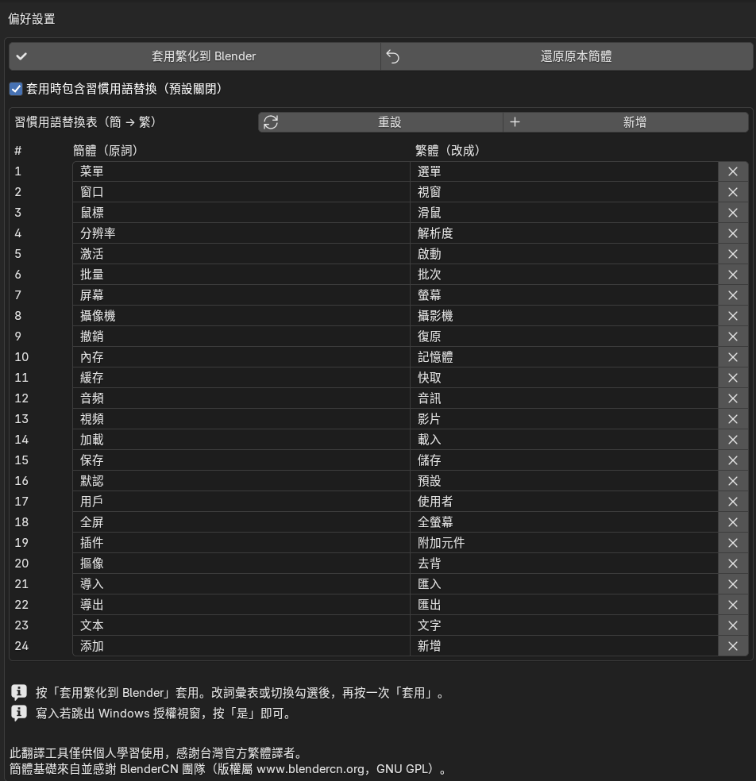

# 繁化助手（Blender 簡中 → 繁體）

把 Blender 內建的**簡體中文**介面換成**繁體中文**，並可選擇性套用台灣習慣用語。一鍵套用、一鍵還原。

> Blender 本身就有在地化的繁體中文（感謝台灣一群無償付出翻譯的熱情開發者們）。只是相對於簡體版，繁體中文版目前很多翻譯仍不完整。這個外掛讓你在繁中完善之前，可以用簡體中文版搭配簡繁轉換來學習。

## 功能

- 一鍵把簡體介面換成繁體（以官方 `zh_HANS` 簡體翻譯**逐字轉繁**為底）
- 可選的「習慣用語替換」：菜單→選單、窗口→視窗、默認→預設…（內建 24 條，可自行增減）
- 
- 一鍵還原回原本簡體
- 寫入受保護資料夾時**自動跳 Windows 授權**，按「是」即可，不需事先設定權限

## 安裝

1. 下載本外掛的 zip（或到 Releases 下載）
2. Blender → 編輯 > 偏好設定 > 附加元件 > 從磁碟安裝 → 選 zip
3. 勾選啟用「繁化助手（簡中→繁體）」

## 使用

1. 在偏好設定裡展開外掛 → 按「**套用繁化到 Blender**」
2. 偏好設定 > 介面 > 翻譯 → 語言選「**简体中文**」（內容已被換成繁體）、勾「介面」
3. 想要台灣用語 → 勾「**套用時包含習慣用語替換**」再按一次套用
4. 還原 → 按「**還原原本簡體**」

> 每次套用/還原後會嘗試即時生效；若介面沒立即改變，重新啟動 Blender 一次即可。

## 注意事項

- 需要寫入 Blender 安裝資料夾。裝在 `Program Files` 時，第一次寫入會跳一次 Windows 授權視窗，按「是」即可（只有那一下需要）。
- 目前對應 **Blender 5.2 LTS** 的簡體翻譯；跨大版本更新時，可能有部分新字串尚未翻譯。

## 致謝與授權

此翻譯工具僅供個人學習使用，感謝台灣官方繁體譯者。
簡體基礎來自並感謝 **BlenderCN 團隊**（版權屬 [www.blendercn.org](https://www.blendercn.org)，GNU GPL）。

- 原始簡體語系檔來源：<https://projects.blender.org/blender/blender-ui-translations/src/branch/main/zh_HANS>
- 內含 [polib](https://github.com/izimobil/polib)（MIT License），用於在執行期產生 `.mo` 語系檔。
- 本外掛以 **GNU GPL** 釋出。
